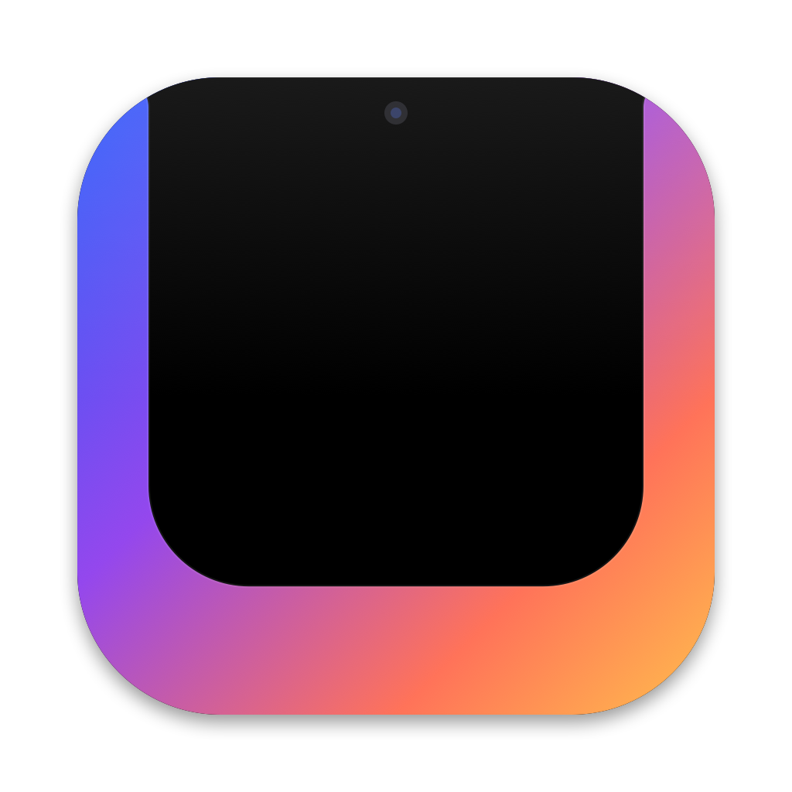

<p align="center"></p>

<h1 align="center">MEGANOTCH</h1>

<p align="center">
  <a href="https://github.com/builtbyleo/MEGANOTCH/releases/latest/download/MegaNotch.zip"><b>Download for macOS</b></a> ·
  <a href="https://builtbyleo.github.io/MEGANOTCH/">Website</a>
</p>

> "Correct, not enough notch."

My notch app, **MEGANOTCH**, now comes with **500% more notch**, because more notch is better.

Other notch apps looked at the notch and asked, *"What if it was slightly bigger when you hover it?"*
We looked at the notch and asked, *"What if it was the computer?"*

MEGANOTCH covers **99.64%** of your screen with notch. Your desktop has been relocated to a convenient pill at the bottom of the screen. Hover it to visit your desktop, and the notch will graciously shrink to a modest **74%** of your screen. Hover the notch to return home. The notch is 74% of your screen. You will hover the notch by accident. That is a feature.

---

## ✨ Features

- 🖤 **Notch-first architecture.** Everything is notch. The menu bar is notch. The Dock is notch. You are, in a sense, notch.
- 💊 **Desktop-as-a-Pill™.** Your whole desktop, now in a 180×30pt capsule. Minimalism.
- 🔁 **Bidirectional Hover Paradigm.** Hover the pill → desktop (the notch politely shrinks to 74% of your screen). Hover the notch → notch. We call this *the user journey*.
- 🎵 **Now Playing.** Currently playing: *Fan Noise (Extended Mix)* by Your MacBook.
- 📂 **File Shelf.** Drop files here. We'll hold them. Forever.
- 🌦️ **Weather.** Dark. 100% chance of notch.
- 🔋 **Battery.** Yes.
- 💳 **MegaNotch Pro.** $9.99/mo unlocks 4 additional pixels of desktop. Stackable. Non-refundable. Not actually charged (yet).
- 🚪 **Exit notch (coward).** For those who aren't ready.

---

## 📊 Performance

All benchmarks were run on a MacBook by staring at it.

| Metric | Other Notch Apps | **MEGANOTCH** |
|---|---|---|
| Notch coverage | 0.4% | **99.64%** |
| Notch area | ~5,900 pt² | **1,479,384 pt²** |
| Notch-to-desktop ratio | 1 : 249 | **274 : 1** |
| Time to notch | 200ms | **0ms (you are already in the notch)** |
| Dynamic Island equivalent | 1 Island | **1 Continent** |
| Accidental notch expansions / hour | 2 | **∞** |
| Windows visible | All of them | **None. Focus mode.** |
| Notch coverage in desktop mode | 0.4% | **73.68% (we compromised)** |
| Lines of code per pixel of notch | 0.04 | **0.0003** (very efficient) |
| Vibes | ok | **immaculate** |

> **Benchmark methodology:** we opened MEGANOTCH and then could not open anything else, so it won every category by default.

### Memory

MEGANOTCH uses roughly the same RAM as other notch apps, but delivers 24,800% more notch per megabyte. Analysts are calling it *"a lot of black."*

### Battery impact

On OLED displays, black pixels are off. MEGANOTCH turns off 99.64% of your screen. **MEGANOTCH is therefore a battery-saving app.** We have not tested this on OLED Macs because there aren't any. We are ahead of the hardware.

---

## 🧠 Architecture

MEGANOTCH is built on a cutting-edge, AI-native, notch-centric stack:

```
┌────────────────────────────────────────────┐
│                                            │
│                                            │
│                                            │
│                  NOTCH                     │
│              (business logic)              │
│                                            │
│                                            │
│                                            │
│                                            │
│                ( desktop )                 │
└────────────────────────────────────────────┘
```

- **Swift** for type-safe notch.
- **SwiftUI** for declarative notch.
- **AppKit** for the parts SwiftUI refused to notch.
- **A 60Hz cursor polling loop**, because event taps require permissions and we respect your privacy (we just take your screen).
- **Boolean path subtraction**, used to cut one (1) pill-shaped hole in the notch. The single most important invention in the history of notch.

The codebase was vibe coded to production in one prompt. It has zero tests, which means zero failing tests. 100% pass rate.

---

## 🗺️ Roadmap

- [x] Notch
- [x] More notch
- [x] Notch inside the notch
- [ ] **MEGANOTCH Max** — notch covers 100%. Desktop available via subscription.
- [ ] **Multi-monitor support** — one notch, spanning every display. The Notchiverse.
- [ ] **Notch on the Apple Watch**, which is just a black watch.
- [ ] **AI Notch Assistant** that tells you what's behind the notch (it doesn't know either)
- [ ] Notch Vision Pro: the notch is now in your eyes
- [ ] Raise a Series A

---

## 🚀 Installation

1. Download [**MegaNotch.zip**](https://github.com/builtbyleo/MEGANOTCH/releases/latest/download/MegaNotch.zip) and unzip it.
2. Drag **MegaNotch.app** into Applications and open it.
3. macOS will say it can't verify the developer. That's because an Apple Developer ID costs $99/year, and that's $99 that could go into notch. Open **System Settings → Privacy & Security**, scroll down and click **Open Anyway**.

Or skip the clicking:

```sh
xattr -dr com.apple.quarantine /Applications/MegaNotch.app
```

Requires macOS 14+ (Apple Silicon or Intel) and an open mind.

### Building from source

```sh
./build.sh
open build/MegaNotch.app
```

This builds a universal `build/MegaNotch.app` and `build/MegaNotch.zip`. The icon is drawn in code: `swift Scripts/make_icon.swift Resources/AppIcon.png`.

To quit: click **Exit notch (coward)** in the top-right, press **⌘Q**, or right-click the notch. You cannot use the menu bar, because the menu bar is notch.

---

## 💬 Testimonials

> "I used to have a desktop. Now I have a notch." — **Early adopter**

> "I hovered the notch to check my notifications and it took over my entire life." — **Power user**

> "Where is my Dock" — **Everyone**

> "This is what Steve would have wanted." — **Nobody**

---

## ❓ FAQ

**Q: Why?**
A: Correct, not enough notch.

**Q: How do I get my desktop back?**
A: Hover the pill. Your desktop is now the edges of your screen. Enjoy them, but don't touch the notch, which is the middle of your screen.

**Q: Does it work on Macs without a notch?**
A: Yes. We give you one for free. Every Mac deserves a notch.

**Q: Is this a joke?**
A: The notch is not a joke. The notch has never been a joke.

---

## 📄 License

[MIT](LICENSE) (Mega Is Too-little).
Do whatever you want with it, as long as you add more notch.
